  <picture>
    <source media="(prefers-color-scheme: dark)" srcset="hafen-dunkel.svg">
    
  </picture>

## 

Informatiker und Bastler aus Überzeugung. Ich baue gern Dinge, die am Ende wirklich online laufen: Datenbank, Backend, Oberfläche, Deployment. Ein grünes Häkchen in der Pipeline macht mich unverhältnismäßig glücklich.

Wenn etwas kaputtgeht, ist das meistens der Moment, in dem ich am meisten lerne. Ein grüner Testlauf ist mein Feierabendgefühl.

## 

| Bereich | Womit ich arbeite |
|---|---|
| **Backend** |    |
| **Frontend** |     |
| **Daten** |  |
| **Tests und DevOps** |    |
| **Cloud** |    |

Außerdem schon gearbeitet mit Laravel, Symfony, Blazor, .NET MAUI, Svelte, Spring Boot, MySQL, SQL Server, Redis, Supabase und Azure.

## Frag mich nach

- warum ein rotes Testergebnis ein guter Freund ist
- warum ein Bug, der nur manchmal auftritt, der schlimmste ist
- wie viele Tabs zu viele Tabs sind
- warum Real Madrid das bessere Team ist

## Abseits vom Code

Sprachen: Deutsch · Français · English

## Sag Moin

Der kürzeste Weg zu mir ist [LinkedIn](https://www.linkedin.com/in/zouhair-ijaad/).

  

  <picture>
    <source media="(prefers-color-scheme: dark)" srcset="https://raw.githubusercontent.com/djzh23/djzh23/output/github-snake-dark.svg">
    <source media="(prefers-color-scheme: light)" srcset="https://raw.githubusercontent.com/djzh23/djzh23/output/github-snake.svg">
    
  </picture>

<i>Läuft bei mir. Hoffentlich auch bei euch.</i>

